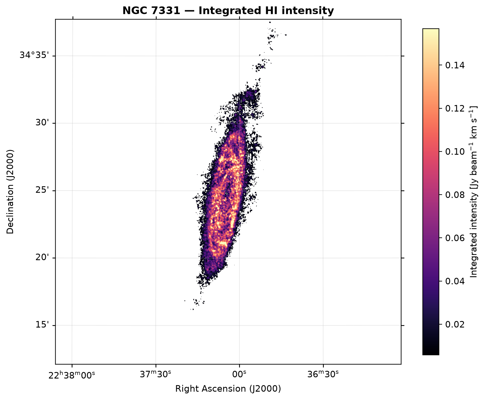
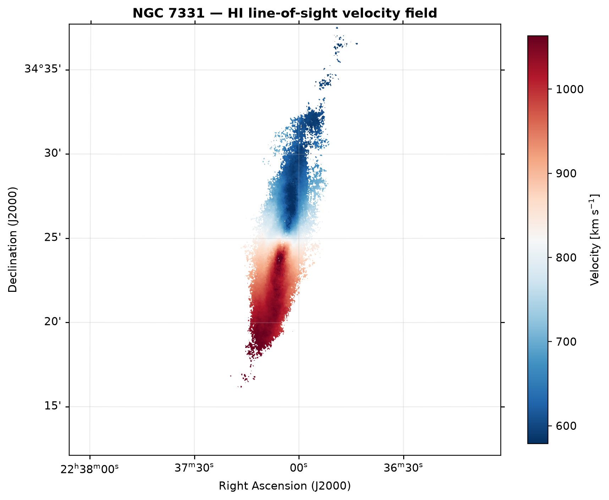
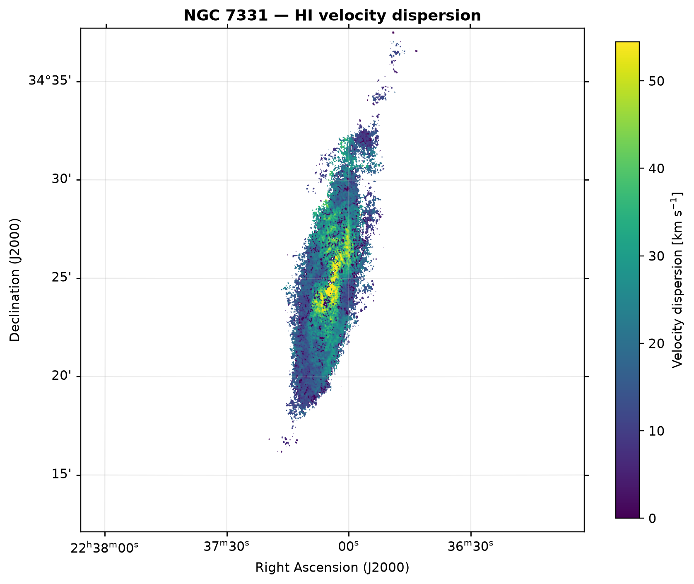
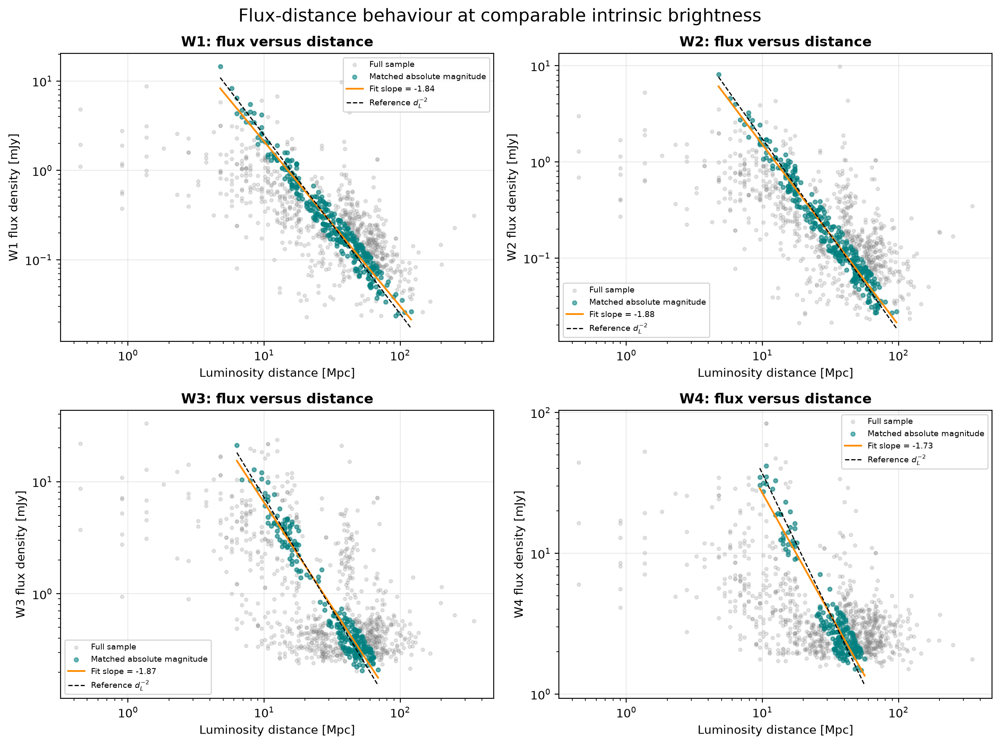
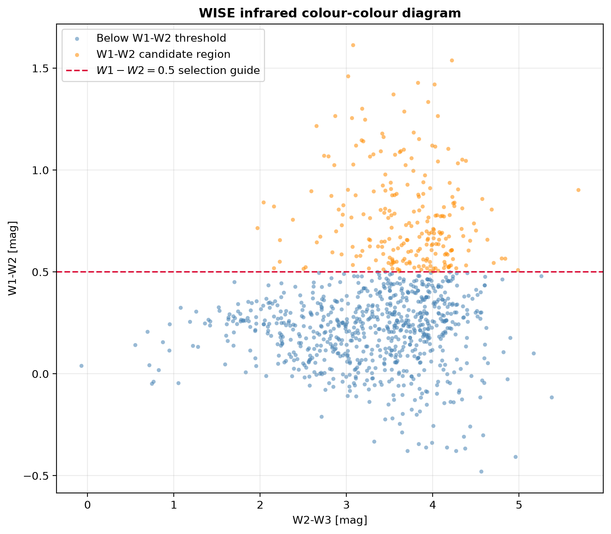

# Multiwavelength Analysis of NGC 7331

A reproducible astronomy project combining WISE mid-infrared catalogue photometry with THINGS 21-cm neutral-hydrogen observations. The analysis calculates calibrated flux densities and band luminosities, measures flux-distance trends, explores infrared colours, and maps the gas structure and kinematics of NGC 7331.

## Showcase

The [executed Jupyter notebook](notebooks/astronomy_analysis.ipynb) contains the full narrative, calculations, tables, and rendered figures. Every code cell has been run.

### HI moment maps







### WISE catalogue analysis





## Analysis

### WISE infrared photometry

The supplied WISE magnitudes are treated as apparent Vega magnitudes. Band-specific Vega zero-magnitude flux densities convert them to flux density:

$$F_\nu = F_{\nu,0}\,10^{-0.4m}$$

The notebook derives distance-corrected absolute magnitudes and monochromatic luminosities (`nu L_nu`). Flux-distance slopes are fitted for sources within a narrow absolute-magnitude range and compared with the inverse-square expectation. W1-W2 and W2-W3 colours are used as population diagnostics; the AGN colour cut identifies candidates only, not confirmed AGN.

The `D_L` values are interpreted as centimetres because that scale gives plausible galaxy distances for the sample. This unit interpretation, like the apparent-magnitude assumption, should be checked against the original catalogue documentation. Extinction, K-corrections, and WISE bandpass colour corrections are not applied, so luminosities are approximate.

### Calculated sample results

| Analysis | Result |
|---|---|
| Complete WISE catalogue sources | 1,000 |
| W1-W2 > 0.5 colour candidates | 230 (23%); candidates, not confirmed AGN |
| Matched-sample W1-W4 flux-distance slopes | -1.85, -1.88, -1.87, -1.73 |
| HI emission-mask median line-of-sight velocity | 808.4 km s⁻¹ |
| HI emission-mask median velocity dispersion | 18.6 km s⁻¹ |

The flux-distance slopes are fitted independently in each WISE band for sources within 0.5 mag of that band's median absolute magnitude; the reference inverse-square slope is -2. HI statistics use a display mask at the 40th percentile of positive Moment 0 pixels to reduce weak background signal.

### HI moment maps

The FITS headers specify Moment 0 in Jy beam⁻¹ m s⁻¹ and Moments 1 and 2 in m s⁻¹. The notebook converts these to Jy beam⁻¹ km s⁻¹ and km s⁻¹ and uses FITS WCS metadata to display sky coordinates.

| Moment | Physical quantity |
|---|---|
| 0 | Integrated HI intensity; traces the neutral-gas distribution |
| 1 | Intensity-weighted line-of-sight velocity; traces rotation |
| 2 | Intensity-weighted velocity dispersion |

## Repository structure

```text
.
|-- notebooks/
|   `-- astronomy_analysis.ipynb
|-- data/
|   `-- WISE_set1.csv
|-- FITS/
|   |-- NGC_7331_NA_MOM0_THINGS.FITS
|   |-- NGC_7331_NA_MOM1_THINGS.FITS
|   `-- NGC_7331_NA_MOM2_THINGS.FITS
|-- results/
|   `-- WISE and HI figures (PNG and PDF)
|-- README.md
`-- requirements.txt
```

## Reproduce the analysis

From the repository root:

```bash
python -m pip install -r requirements.txt
jupyter notebook notebooks/astronomy_analysis.ipynb
```

The notebook also locates the project root when launched from its `notebooks/` directory. Dependencies are listed in [requirements.txt](requirements.txt).

## References

- [WISE All-Sky Release Explanatory Supplement — Photometric Calibration](https://wise2.ipac.caltech.edu/docs/release/allsky/expsup/sec4_4h.html)
- [THINGS survey data products](https://www.mpia.de/THINGS/Overview.html)
- [Astropy documentation](https://docs.astropy.org/)
